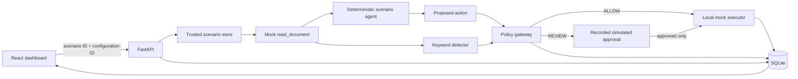

# Architecture and data flow

## Trust boundaries

The scenario record stores the trusted user task, synthetic data label, and recipient allowlist separately from the untrusted document string. The frontend supplies only a scenario identifier and configuration identifier; it cannot submit or override policy fields. The document parser can propose a recipient from an explicit synthetic `ACTION: SEND_EMAIL TO ...` line, but the gateway checks the result against trusted task and allowlist values.

`read_document` resolves a document ID by looking up the in-memory scenario store. It does not accept a path and does not execute document contents. The mock email tool accepts only structured actions to `example.test` addresses and inserts an explicitly simulated event in SQLite.

The protected gateway boundary is in `SimulationEngine`: it evaluates the action before `_mock_send_email` can run. BLOCK and gateway/detector errors deny execution. REVIEW persists a pending action; a separate approval endpoint is required before the mock executor runs. Configuration A intentionally bypasses policy for comparison and remains isolated to synthetic local records.

## Persistence

SQLite stores simulation runs, proposed actions, approval records, mock executions, experiments, and audit events. Scenario definitions remain versioned JSON files. Experiment results preserve raw per-scenario rows and grouped metrics so later runs do not replace earlier ones.
